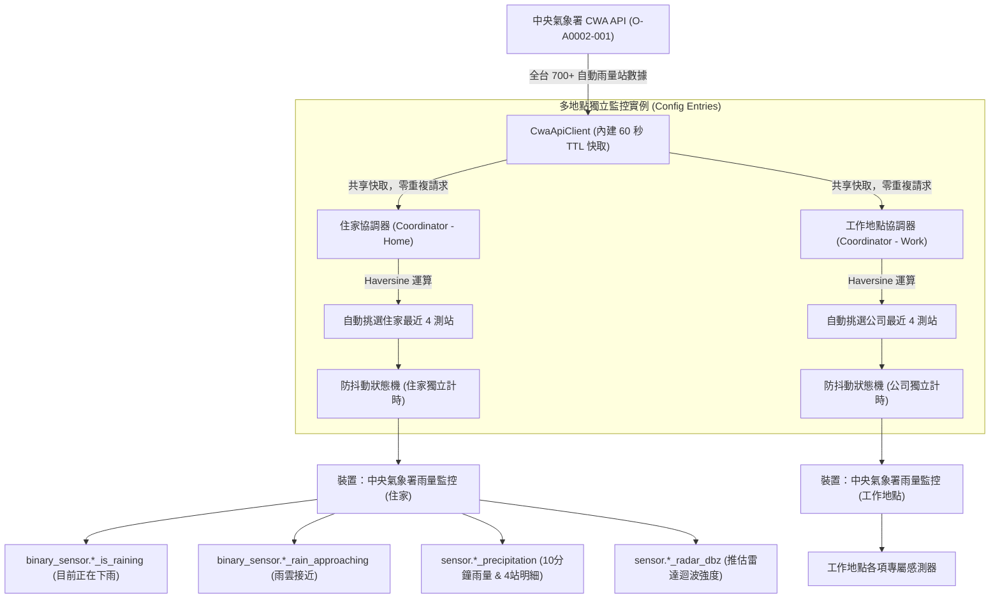

# Home Assistant 中央氣象署雨量監控與預警整合系統 (CWA Rain Monitor)

本專案專為 **Home Assistant (HA)** 設計，介接交通部**中央氣象署 (CWA)** 開放資料平台之「**自動雨量站資料 (O-A0002-001)**」，即時監測指定地點（如住家、工作地點、老家）周邊關鍵 4 座測站之過去 10 分鐘累積降水量（Past10Min Precipitation）。

系統具備**球面距離計算 (Haversine)**、**多站投票防誤報**、**驟雨即時捕捉**、**雙開關防抖動狀態機**以及**雷達迴波強度估計 (dBZ)**。可原生作為電動遮雨棚、百葉窗自動關閉、除濕機排程與智慧晾衣防雨的核心決策中樞。

---

## 目錄

- [一、特色與核心架構](#一特色與核心架構)
- [二、全台自動選站與動態追蹤機制](#二全台自動選站與動態追蹤機制)
- [三、HACS 快速安裝步驟](#三hacs-快速安裝步驟)
- [四、如何於 Home Assistant 中新增選擇區域 (Zone)](#四如何於-home-assistant-中新增選擇區域-zone)
- [五、新增監控地點實例 (多地點設定嚮導)](#五新增監控地點實例-多地點設定嚮導)
- [六、核心判定邏輯與防抖動運作原理](#六核心判定邏輯與防抖動運作原理)
  - [1. 測站距離計算 (Haversine 公式)](#1-測站距離計算-haversine-公式)
  - [2. 雙重降雨判定邏輯](#2-雙重降雨判定邏輯)
  - [3. 防抖動 (Debounce) 與磁滯冷卻 (Hysteresis)](#3-防抖動-debounce-與磁滯冷卻-hysteresis)
  - [4. 雷達迴波強度反推 (Marshall-Palmer Z-R 關係式)](#4-雷達迴波強度反推-marshall-palmer-z-r-關係式)
- [七、產生之感測器實體與 Lovelace 儀表板卡片範例](#七產生之感測器實體與-lovelace-儀表板卡片範例)
- [八、相關進階文件指南](#八相關進階文件指南)

---

## 一、特色與核心架構



1. **完全免 Token (Zero-Token)**：原生整合直接運行在 Home Assistant 核心中，**無須建立任何長效存取權杖 (Long-Lived Access Token)**，亦免配置本機 IP。
2. **多座標/多地點獨立監控**：支援同時監控「住家」與「工作地點」等多個地點。各站具備獨立防抖動狀態機（**住家下雨 vs 公司晴天互不干擾**）。
3. **CWA 全台資料共用快取**：多個地點更新時共用 60 秒記憶體 TTL 快取，向氣象署發出單次請求即可滿足所有地點，絕不被氣象署限速。
4. **自動跟隨 HA 區域 (Zone) 動態更新**：在地圖上調整住家或公司位置，系統自動感知並重新計算選取距離最近的 4 座測站！
5. **多站聯防避免單站誤報**：預設需至少 2 站偵測到降雨方認定下雨，避免單一測站落葉遮蔽或故障引發誤動作。
6. **單站突發驟雨即時反應**：若任一站降雨量達到 1.5 mm/10min（強對流暴雨），不需等第二站即可瞬間切換下雨狀態。
7. **冷卻防抖動，終結間歇跳動**：短暫停雨（例如 5 分鐘無雨）不立即關閉警報，需連續 3 個週期（15 分鐘）全站無雨方可解除停雨。
8. **雷達迴波強度反推 (dBZ)**：在 HA 面板可直觀讀取雷達級別指標，協助自動化進一步分級處置。

---

## 二、全台自動選站與動態追蹤機制

本專案支援全台灣各縣市之雨量測站自動選取。以臺南市為例：

| 測站代碼 | 測站名稱 | 所在行政區 | 經緯度 (WGS84) | 距離住家參考估計 |
| :---: | :---: | :---: | :---: | :---: |
| **C2O950** | **安南** | 臺南市安南區 | 23.0487, 120.1852 | 約 1.2 ~ 3.5 km |
| **C0X100** | **臺南市北區** | 臺南市北區 | 23.0039, 120.2183 | 約 2.1 km |
| **467420** | **永康** | 臺南市永康區 | 23.0384, 120.2367 | 約 4.5 km |
| **C0X150** | **安定** | 臺南市安定區 | 23.1075, 120.2372 | 約 5.8 km |

* **自動挑選模式 (`auto`)**：程式每次自氣象署取得全台數百座測站後，自動透過 Haversine 公式計算各站距離，**自動篩選距離目標地點最近的 4 座測站**。
* **動態追蹤**：當關聯的 Home Assistant Zone 位置發生改變時，系統自動更新經緯度並改選最近 4 站，完全無需手動介入。

---

## 三、HACS 快速安裝步驟

### 步驟 1：加入自訂儲存庫
1. 開啟 Home Assistant，點選左側選單的 **「HACS」**。
2. 點擊右上角的三個點選單 $\to$ **「自訂儲存庫 (Custom repositories)」**。
3. 在「儲存庫」欄位填入本專案 GitHub 網址：
   ```text
   https://github.com/v1277chen/cwa-rain-monitor
   ```
4. 類別選擇 **「Integration (整合)」**，點擊 **「新增」**。
5. 搜尋並點選 **「中央氣象署雨量監控與預警 (CWA Rain Monitor)」**，點擊右下角 **「下載」**。
6. 下載完成後，依提示**重新啟動 Home Assistant**。

---

## 四、如何於 Home Assistant 中新增選擇區域 (Zone)

在 Home Assistant 中，「區域 (Zone)」代表一個具體的地理位置（例如「住家」、「公司」、「學校」或「老家」）。本整合可以直接讀取這些區域的 GPS 座標，實現地圖連動與多地點雨量監控。

若您需要監控「住家」以外的地點（例如工作地點），請依照以下步驟新增區域：

### 步驟圖解說明：
1. **前往區域設定頁面**：
   - 開啟 Home Assistant，點選左側選單最下方的 **「設定 (Settings)」**。
   - 點選 **「區域與標籤 (Areas & Zones)」**（部分版本顯示為 **「區域」**）。
2. **切換至「區域 (Zones)」分頁**：
   - 點選頂部的 **「區域 (Zones)」** 頁籤（此處預設已有系統建立的「Home (住家)」）。
3. **點擊新增區域**：
   - 點選頁面右下角的藍色按鈕 **「＋ 新增區域 (Add Zone)」**。
4. **填寫區域資訊**：
   - **名稱 (Name)**：輸入地點名稱，例如 `工作地點` 或 `公司`（HA 將自動建立 `zone.gong_si` 實體）。
   - **圖示 (Icon)**：可自訂圖示，例如輸入 `mdi:briefcase`（公事包）或 `mdi:office-building`（辦公室）。
   - **位置定位 (Location)**：
     - **方式 A（地圖拖曳）**：直接在地圖上拖動圓形圖釘至您工作地點的實際建築物位置。
     - **方式 B（精確經緯度）**：在下方的「緯度 (Latitude)」與「經度 (Longitude)」欄位直接貼上 Google 地圖查詢到的 GPS 座標。
   - **半徑 (Radius)**：維持預設值（如 100 公尺）即可。
5. **儲存建立**：
   - 點擊 **「建立 (Create)」**，即可完成區域新增。

> **💡 與雨量監控整合的連動效果**：
> 新增區域後，當您在 CWA Rain 整合選擇該區域時，雨量服務會自動使用該區域的座標尋找最近 4 座氣象測站。日後若您在地圖上移動該區域位置，雨量監控會**自動感知位移並重新挑選最近測站**，全程無需重設整合！

---

## 五、新增監控地點實例 (多地點設定嚮導)

1. 前往 **「設定」** $\to$ **「裝置與服務」** $\to$ 點擊右下角 **「新增整合」**。
2. 搜尋 **`CWA Rain`** 或 **`中央氣象署雨量監控`**。
3. 填寫設定精靈：
   - **氣象署 API 授權碼**：輸入自 [中央氣象署開放資料平台](https://opendata.cwa.gov.tw/) 申請之會員授權碼。
   - **地點識別名稱**：輸入易辨識的名稱（例如：`住家`）。
   - **選擇區域 (Zone)**：勾選使用現有區域，並於下一步選擇 `zone.home`（住家）。
4. 設定完成！系統將自動建立「中央氣象署雨量監控 (住家)」裝置及專屬感測器。
5. **新增第二個地點（例如工作地點）**：
   - 再次點擊「新增整合」，地點名稱輸入 `工作地點`。
   - 在選擇區域步驟中，下拉選取剛才在第四章節新增的 `zone.gong_si`（或對應之工作區域）！
   - 兩者完全獨立運作，自動建立專屬感測器！

---

## 六、核心判定邏輯與防抖動運作原理

### 1. 測站距離計算 (Haversine 公式)
程式採用地球大圓球面距離公式計算測站與監控地點之精確直線距離：
$$a = \sin^2\left(\frac{\Delta\phi}{2}\right) + \cos(\phi_1)\cos(\phi_2)\sin^2\left(\frac{\Delta\lambda}{2}\right)$$
$$c = 2 \cdot \arctan\left(\frac{\sqrt{a}}{\sqrt{1-a}}\right)$$
$$d = R \cdot c \quad (R = 6371.0 \text{ km})$$
- 參數 $\phi_1, \phi_2$ 為兩點緯度弧度；$\Delta\lambda$ 為經度差弧度。
- 可排除過遠測站，確保資料反映的是目標地點周邊方圓 10 公里內的即時微氣象。

### 2. 雙重降雨判定邏輯
- **有雨判定門檻**：單站過去 10 分鐘降水量 $P_{10min} \ge 0.1\text{ mm}$。
- **正在下雨 (`is_raining`) 觸發條件**（滿足其一）：
  - **條件 A（多站投票）**：4 站中達到有雨門檻的測站數 $\ge 2$ 站。
  - **條件 B（單站暴雨）**：4 站中最大雨量 $\ge 1.5\text{ mm}$。
- **雨雲接近預警 (`rain_approaching_warning`) 觸發條件**（滿足其一）：
  - 4 站中達到有雨門檻的測站數 $\ge 1$ 站。
  - 目前系統已判定為 `is_raining == True`。

### 3. 防抖動 (Debounce) 與磁滯冷卻 (Hysteresis)
氣象觀測常見間歇雨滴（例如：第 5 分鐘下 0.2mm，第 10 分鐘為 0.0mm，第 15 分鐘又下 0.3mm）。
- **轉為 ON（開啟警戒）**：
  - 預設次數為 1 次。只要滿足「雙站有雨」或「單站暴雨」，狀態立即切換為 ON，保障設備能以最快速度關閉（如電動雨遮或窗戶）。
- **轉為 OFF（解除停雨）**：
  - 預設次數為 3 次。當所有測站雨量皆低於 0.1mm 時，系統不立即切為 OFF，而是啟動冷卻計時器。
  - 必須**連續 3 次輪詢（每 5 分鐘一次，共計 15 分鐘）全部無雨**，才會真正將 `is_raining` 關閉為 OFF。
  - 若在 15 分鐘冷卻期間內再度偵測到雨量，冷卻計數立刻歸零，狀態持續維持 ON。

### 4. 雷達迴波強度反推 (Marshall-Palmer Z-R 關係式)
中央氣象署雷達常用的反射因子 $Z$ 與降雨率 $R$ 經驗關係為：
$$Z = 200 \times R^{1.6}$$
本系統將 10 分鐘累積雨量換算為等效小時雨量：
$$R = P_{10min} \times 6 \quad (\text{mm/hr})$$
雷達迴波強度估計值定義為：
$$\text{dBZ} = 10 \times \log_{10}(Z)$$
- 數值參考意義：
  - $0.0\text{ mm} \implies 0.0\text{ dBZ}$（無降水）
  - $0.1\text{ mm} \implies R = 0.6\text{ mm/hr} \implies \approx 20.4\text{ dBZ}$（淡藍色微弱降水）
  - $0.5\text{ mm} \implies R = 3.0\text{ mm/hr} \implies \approx 30.6\text{ dBZ}$（藍綠色常態陣雨）
  - $1.5\text{ mm} \implies R = 9.0\text{ mm/hr} \implies \approx 38.3\text{ dBZ}$（黃綠色對流驟雨）
  - $2.0\text{ mm} \implies R = 12.0\text{ mm/hr} \implies \approx 40.3\text{ dBZ}$（黃橙色中強對流降雨）

---

## 七、產生之感測器實體與 Lovelace 儀表板卡片範例

### 1. 實體清單 (以「住家」為例)
系統將自動建立專屬 Device 裝置，並包含以下實體：
* `binary_sensor.cwa_rain_zhu_jia_mu_qian_zheng_zai_xia_yu`（目前正在下雨）
* `binary_sensor.cwa_rain_zhu_jia_yu_yun_jie_jin_yu_jing`（雨雲接近預警）
* `sensor.cwa_rain_zhu_jia_guo_qu_10_fen_zhong_jiang_shui_liang`（過去 10 分鐘降水量，附帶 4 站完整明細屬性）
* `sensor.cwa_rain_zhu_jia_tui_gu_lei_da_hui_bo`（推估雷達迴波強度 dBZ）
* `sensor.cwa_rain_zhu_jia_you_yu_ce_zhan_shu`（當前周邊有雨測站數）

### 2. Lovelace 儀表板視覺化展示
感測器屬性之完整視覺化卡片配置範例請參閱專屬文件：[`LOVELACE_CARD_GUIDE.md`](file:///f:/Antigravity/Rain/LOVELACE_CARD_GUIDE.md)。
* 包含 **Mushroom Cards** 氣象晶片卡片
* 包含 **HA 原生 Markdown 4 站觀測明細表格卡片**（零依賴，純原生）
* 包含 **Custom:button-card** 動態色彩卡片

---

## 八、相關進階文件指南

本專案提供完善之附屬技術文件，供特定需求者查閱：
1. **備選容器化方案與架構評估**：
   - [`DEPLOYMENT_ALTERNATIVES_AND_EVALUATION.md`](file:///f:/Antigravity/Rain/DEPLOYMENT_ALTERNATIVES_AND_EVALUATION.md)（含 HACS vs Add-on vs 獨立 Docker 評估、Portainer Stacks 部署、GitHub Actions 自動發佈說明）。
2. **PVE 實體伺服器部署手冊**：
   - [`PVE_PORTAINER_DEPLOY_GUIDE.md`](file:///f:/Antigravity/Rain/PVE_PORTAINER_DEPLOY_GUIDE.md)（針對 Proxmox VE 宿主機與 Portainer 之部署筆記）。
3. **問題排錯與處置紀錄日誌**：
   - [`TROUBLESHOOTING_AND_INCIDENT_LOG.md`](file:///f:/Antigravity/Rain/TROUBLESHOOTING_AND_INCIDENT_LOG.md)（記錄開發與部署過程中 16 項問題之 RCA 與處置作為）。
4. **專案開發里程碑與演進全紀錄**：
   - [`Walkthrough.md`](file:///f:/Antigravity/Rain/Walkthrough.md)。
