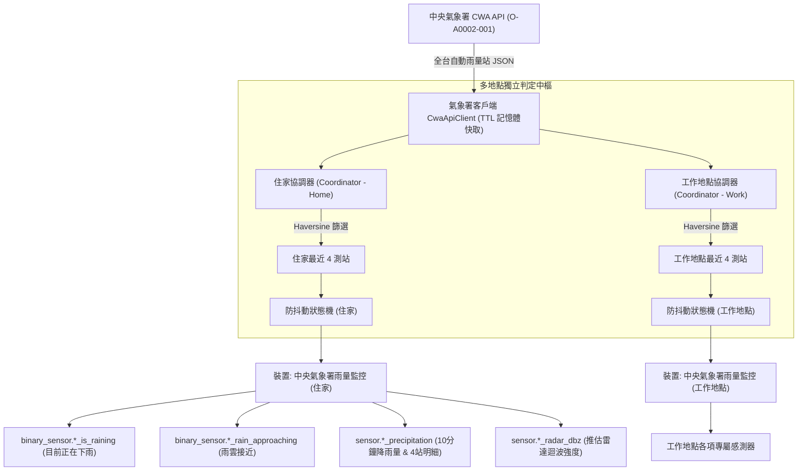

# Home Assistant 中央氣象署雨量監控與預警整合系統

本專案專為 **Home Assistant (HA)** 智慧家居設計，介接交通部**中央氣象署 (CWA)** 開放資料平台之「**自動雨量站資料 (O-A0002-001)**」，即時監測使用者住家周圍關鍵 4 座測站之過去 10 分鐘累積降水量（Past10Min Precipitation）。

系統具備**球面距離計算 (Haversine)**、**多站投票防誤報**、**驟雨即時捕捉**、**雙開關防抖動狀態機**以及**雷達迴波強度估計 (dBZ)**，能夠平穩、精準地連動 Home Assistant 的開關與感測器，作為電動遮雨棚、百葉窗自動關閉、除濕機排程與智慧晾衣防雨的核心決策中樞。

---

## 目錄

- [一、需求架構與特色](#一需求架構與特色)
- [二、監控測站配置與動態切換機制](#二監控測站配置與動態切換機制)
- [三、首選安裝：HACS 自訂整合安裝指南 (免 Token、支援多地點)](#三首選安裝hacs-自訂整合安裝指南-免-token支援多地點)
- [四、核心運作機制深度分析](#四核心運作機制深度分析)
  - [1. 測站距離計算 (Haversine 公式)](#1-測站距離計算-haversine-公式)
  - [2. 雙重降雨判定邏輯](#2-雙重降雨判定邏輯)
  - [3. 防抖動 (Debounce) 與磁滯冷卻 (Hysteresis)](#3-防抖動-debounce-與磁滯冷卻-hysteresis)
  - [4. 雷達迴波強度反推 (Marshall-Palmer Z-R 關係式)](#4-雷達迴波強度反推-marshall-palmer-z-r-關係式)
- [五、方案評估：HACS 整合 vs Add-on vs 獨立 Docker 容器](#五方案評估hacs-整合-vs-add-on-vs-獨立-docker-容器)
- [六、備選安裝：Portainer Stacks (Docker Compose) 容器化部署](#六備選安裝portainer-stacks-docker-compose-容器化部署)
- [七、自動部署至 GitHub Pages 與 HACS Action](#七自動部署至-github-pages-與-hacs-action)
- [八、維護與函式規格說明](#八維護與函式規格說明)
- [九、問題排錯與處置紀錄 (Troubleshooting)](#九問題排錯與處置紀錄-troubleshooting)

---

## 一、需求架構與特色

本專案支援 **HACS 原生自訂整合 (Custom Integration)** 與 **外部獨立 Python Docker 服務** 雙軌架構。



1. **完全免 Token (HACS 模式)**：直接於 Home Assistant 核心非同步事件迴圈運作，零設定 Token 門檻。
2. **多座標/多地點支援**：可同時監控「住家」、「公司」或更多地點，內建 TTL 共享快取，絕不對氣象署重複請求。
3. **自動跟隨 HA 區域 (Zone) 動態更新**：在地圖上拖曳住家或公司位置，系統自動重新挑選周邊最近 4 座測站！
4. **多站聯防避免單站誤報**：避免單一測站落葉、灰塵遮蔽或設備故障造成家電頻繁誤動作。
5. **單站突發驟雨即時反應**：若任一站降雨量達到 1.5 mm/10min（強對流暴雨），不需等第二站即可瞬間切換下雨狀態。
6. **冷卻防抖動，終結間歇跳動**：短暫停雨（例如 5 分鐘無雨）不會立即關閉警報，需連續 3 個週期（15 分鐘）全站無雨方可解除。
7. **雷達迴波強度反推 (dBZ)**：在 HA 面板可直觀讀取雷達級別指標，協助自動化進一步分級處置。

---

## 二、監控測站配置與動態切換機制

本專案支援全台灣各縣市之雨量測站自動選取。以臺南市為例：

| 測站代碼 | 測站名稱 | 所在行政區 | 經緯度 (WGS84) | 距離住家參考估計 |
| :---: | :---: | :---: | :---: | :---: |
| **C2O950** | **安南** | 臺南市安南區 | 23.0487, 120.1852 | 約 1.2 ~ 3.5 km |
| **C0X100** | **臺南市北區** | 臺南市北區 | 23.0039, 120.2183 | 約 2.1 km |
| **467420** | **永康** | 臺南市永康區 | 23.0384, 120.2367 | 約 4.5 km |
| **C0X150** | **安定** | 臺南市安定區 | 23.1075, 120.2372 | 約 5.8 km |

### 🚀 住家/公司經緯度變更時的「自動距離動態切換」
1. **自動切換最近 4 座測站模式 (`selection_mode: "auto"`)**：
   - 程式每次取得全台數百座測站後，自動透過 Haversine 公式計算各站與該地點之大圓球面距離，自動挑選**最近的 4 座測站**。
2. **自動向 Home Assistant 區域 (Zone) 即時同步座標**：
   - 啟用 `auto_sync_zone: true` 時，若使用者在 Home Assistant「設定 $\to$ 區域」變更了地圖上的位置，系統每輪會自動更新經緯度並改選最近 4 站，完全無需手動修改或重啟！

---

## 三、首選安裝：HACS 自訂整合安裝指南 (免 Token、支援多地點)

### 步驟 1：透過 HACS 加入自訂儲存庫
1. 開啟 Home Assistant，點選左側選單的 **「HACS」**。
2. 點擊右上角的三個點選單 $\to$ **「自訂儲存庫 (Custom repositories)」**。
3. 在「儲存庫」欄位填入本專案 GitHub 網址：
   ```text
   https://github.com/v1277chen/Rain
   ```
4. 類別選擇 **「Integration (整合)」**，點擊 **「新增」**。
5. 搜尋並點選 **「中央氣象署雨量監控與預警 (CWA Rain Monitor)」**，點擊右下角 **「下載」**。
6. 下載完成後，依提示**重新啟動 Home Assistant**。

### 步驟 2：新增監控地點 (UI 設定嚮導)
1. 前往 **「設定」** $\to$ **「裝置與服務」** $\to$ 點擊右下角 **「新增整合」**。
2. 搜尋 **`CWA Rain`** 或 **`中央氣象署雨量監控`**。
3. 填寫設定：
   - **氣象署 API 授權碼**：輸入自氣象署開放資料平台申請的 API Key。
   - **地點識別名稱**：例如輸入 `住家`。
   - **選擇區域 (Zone)**：勾選使用現有區域，並於下一步選擇 `zone.home`（或選擇 `zone.work`）。
4. 設定完成！系統將自動建立「中央氣象署雨量監控 (住家)」裝置及相關感測器。
5. **若要新增第二個地點（例如工作地點）**：
   只需再次點擊「新增整合」，地點名稱輸入 `公司`，區域選擇 `zone.work` 即可！兩者獨立運作，自動產生專屬感測器！

---

## 四、核心運作機制深度分析

### 1. 測站距離計算 (Haversine 公式)
為了準確衡量測站對指定地點（住家或工作地點）的地理代表性，程式採用大圓球面距離公式計算：
$$a = \sin^2\left(\frac{\Delta\phi}{2}\right) + \cos(\phi_1)\cos(\phi_2)\sin^2\left(\frac{\Delta\lambda}{2}\right)$$
$$c = 2 \cdot \arctan\left(\frac{\sqrt{a}}{\sqrt{1-a}}\right)$$
$$d = R \cdot c \quad (R = 6371.0 \text{ km})$$
- 參數 $\phi_1, \phi_2$ 為兩點緯度弧度；$\Delta\lambda$ 為經度差弧度。
- 可排除過遠測站，確保資料反映的是目標地點周邊方圓 10 公里內的即時微氣象。

### 2. 雙重降雨判定邏輯
- **有雨判定門檻**：單站過去 10 分鐘降水量 $P_{10min} \ge 0.1\text{ mm}$。
- **正在下雨 (`is_raining`) 觸發條件**（滿足其一）：
  - **條件 A（多站投票）**：4 站中達到有雨門檻的測站數 $\ge 2$ 站。
  - **條件 B（單站暴雨）**：4 站中最大雨量 $\ge 1.5\text{ mm}$。
- **雨雲接近預警 (`rain_approaching_warning`) 觸發條件**（滿足其一）：
  - 4 站中達到有雨門檻的測站數 $\ge 1$ 站。
  - 目前系統已判定為 `is_raining == True`。

### 3. 防抖動 (Debounce) 與磁滯冷卻 (Hysteresis)
氣象觀測常見間歇雨滴（例如：第 5 分鐘下 0.2mm，第 10 分鐘為 0.0mm，第 15 分鐘又下 0.3mm）。
- **轉為 ON（開啟警戒）**：
  - 預設次數為 1 次。只要滿足「雙站有雨」或「單站暴雨」，狀態立即切換為 ON，保障設備能以最快速度關閉（如電動雨遮或窗戶）。
- **轉為 OFF（解除停雨）**：
  - 預設次數為 3 次。當所有測站雨量皆低於 0.1mm 時，系統不立即切為 OFF，而是啟動冷卻計時器。
  - 必須**連續 3 個輪詢週期（共 15 分鐘）全無降雨**，才會真正將 `is_raining` 關閉為 OFF。
  - 若在冷卻期間任一測站再次測得降雨，冷卻計數立即歸零，狀態持續維持 ON。

### 4. 雷達迴波強度反推 (Marshall-Palmer Z-R 關係式)
中央氣象署的雷達迴波圖常以 dBZ 表示對流強度。本系統利用氣象雷達經典經驗公式將 10 分鐘雨量換算為估計 dBZ：
1. **等效降雨率**：$R = P_{10min} \times 6\text{ (mm/hr)}$
2. **反射率因子**：$Z = 200 \times R^{1.6}$
3. **雷達迴波強度**：$\text{dBZ} = 10 \times \log_{10}(Z)$
- 數值參考意義：
  - $0.0\text{ mm} \implies 0.0\text{ dBZ}$（無降水）
  - $0.1\text{ mm} \implies R = 0.6\text{ mm/hr} \implies \approx 20.4\text{ dBZ}$（淡藍色微弱降水）
  - $0.5\text{ mm} \implies R = 3.0\text{ mm/hr} \implies \approx 30.6\text{ dBZ}$（藍綠色常態陣雨）
  - $1.5\text{ mm} \implies R = 9.0\text{ mm/hr} \implies \approx 38.3\text{ dBZ}$（黃綠色對流驟雨）
  - $2.0\text{ mm} \implies R = 12.0\text{ mm/hr} \implies \approx 40.3\text{ dBZ}$（黃橙色中強對流降雨）

---

## 五、方案評估：HACS 整合 vs Add-on vs 獨立 Docker 容器

| 評估維度 | **HACS 自訂整合 (首選推薦 ⭐)** | **Home Assistant Add-on** | **Portainer 獨立 Docker 容器** |
| :--- | :--- | :--- | :--- |
| **鑑權機制** | **完全免 Token** (直接呼叫 HA 內部記憶體 API) | 免手動 Token (Supervisor 自動注入) | 需手動建立 Long-Lived Access Token |
| **多座標支援度** | **最佳**：原生支援 UI 重複新增實例 (住家一個、公司一個)，內建全台 API 共享快取 | 普通：需手動編輯 Options YAML/JSON | 普通：需於 Compose 設定多環境變數或啟動多容器 |
| **通訊延遲與效能** | **最優 (零網路開銷)**：微秒級記憶體傳遞 | 次之：走容器內部虛擬網卡打 REST API | 普通：走區域網路或 Host 網路打 REST API |
| **資源消耗** | **極低** (約 3~8 MB，共用 HA Python 執行環境) | 較大 (約 40~80 MB 獨立 Linux 容器) | 較大 (約 40~80 MB 獨立 Linux 容器) |
| **系統相容度** | **100% 全相容** (HA OS, Container, Supervised, Core) | **受限** (⚠️ 僅限 HA OS / Supervised，純 Docker 無法安裝) | **100% 全相容** (任何具備 Docker 環境之主機均可) |

---

## 六、備選方案：Portainer Stacks (Docker Compose) 容器化部署指南

若您偏好外部進程解耦（例如希望 HA 核心升級或重啟時，雨量計時服務依然在外部持續計時），可採用此獨立容器方案。
* 通用 Portainer 部署指南請參見：[`PORTAINER_DOCKER_DEPLOY_GUIDE.md`](file:///f:/Antigravity/Rain/PORTAINER_DOCKER_DEPLOY_GUIDE.md)
* **PVE (192.168.0.110) 專屬實戰部署手冊**（含 SCP 傳檔與 `docker build` 步驟）：[`PVE_PORTAINER_DEPLOY_GUIDE.md`](file:///f:/Antigravity/Rain/PVE_PORTAINER_DEPLOY_GUIDE.md)

### 1. Portainer Stack 快速貼上範本 (`docker-compose.yml`)

```yaml
version: '3.8'

services:
  cwa-rain-monitor:
    container_name: cwa-rain-monitor
    image: cwa-ha-rain-monitor:latest
    restart: unless-stopped
    # 推薦使用 host 網路，免去 Docker 虛擬網路隔離與 DNS 延遲
    network_mode: host
    environment:
      - TZ=Asia/Taipei
      - PYTHONUNBUFFERED=1
      # 【必填】氣象署授權碼
      - CWA_API_TOKEN=YOUR_CWA_API_KEY_HERE
      # 【必填】Home Assistant 實體區網網址 (不可用 homeassistant.local 若在 bridge 模式)
      - HA_BASE_URL=http://192.168.1.100:8123
      # 【必填】Home Assistant 長效存取權杖
      - HA_ACCESS_TOKEN=YOUR_HA_LONG_LIVED_ACCESS_TOKEN_HERE
      # 【選填】住家經緯度與測站模式
      - HOME_LATITUDE=23.0150
      - HOME_LONGITUDE=120.2050
      - STATION_SELECTION_MODE=auto
      - AUTO_SYNC_HA_ZONE=true
      # 【選填】判定門檻與防抖動 (預設 5 分鐘輪詢，15 分鐘連續無雨才關閉)
      - RAIN_DETECTED_MM=0.1
      - HEAVY_RAIN_MM=1.5
      - POLLING_INTERVAL_SECONDS=300
      - DEBOUNCE_OFF_COUNT=3
      - DEBOUNCE_ON_COUNT=1
    deploy:
      resources:
        limits:
          cpus: '0.20'
          memory: 128M
```

---

## 七、自動部署至 GitHub Pages 與 HACS Action

本專案支援 GitHub 全自動化維護：
1. **GitHub Pages (`.github/workflows/deploy.yml`)**：
   - 當推送至 `main` 分支時，自動編譯並部署互動式中文雷達模擬器與專案介紹。
2. **HACS 官方整合驗證與測試 (`.github/workflows/validate.yml`)**：
   - 自動檢驗 `hacs.json` 與 `custom_components/cwa_rain` 是否符合 Home Assistant 最新 HACS 規範。
   - 自動執行 Python 單元測試，確保物理公式與多地點獨立狀態機運作無誤。

---

## 八、維護與函式規格說明

| 模組 / 函式 | 參數型態 | 回傳值型態 | 功能說明 |
| :--- | :--- | :--- | :--- |
| `haversine_distance(lat1, lon1, lat2, lon2)` | `(float, float, float, float)` | `float` | 計算地球表面兩點之大圓球面距離 (公里 km)。 |
| `calculate_estimated_dbz(past_10min_rain_mm)` | `(float)` | `float` | 套用 Marshall-Palmer $Z=200\times R^{1.6}$ 氣象經驗模型，由 10 分鐘雨量換算雷達迴波強度 (dBZ)。 |
| `CwaApiClient.async_fetch_stations()` | 無 | `List[Dict[str, Any]]` | 非同步向氣象署 API 抓取全台雨量測站，內建 60 秒 TTL 快取供多座標共享。 |
| `CwaRainDataUpdateCoordinator._select_four_stations(all_stations)` | `(List[Dict[str, Any]])` | `List[Dict[str, Any]]` | 依據當前座標挑選最近 4 站，若測站更換則記錄日誌。 |
| `RainDebounceStateMachine.evaluate(selected_stations)` | `(List[Dict[str, Any]])` | `Dict[str, Any]` | 各地點獨立狀態機，執行多站投票與連續冷卻判定。 |
| `StationEvaluator.update_home_location(new_lat, new_lon)` | `(float, float)` | `bool` | 外部獨立服務模式中動態更新住家經緯度座標。 |

---

## 九、問題排錯與處置紀錄 (Troubleshooting)

本專案在開發與部署過程中所遭遇之各項異常、根本原因 (RCA) 與處理措施已全數彙整至獨立紀錄檔：[`TROUBLESHOOTING_AND_INCIDENT_LOG.md`](file:///f:/Antigravity/Rain/TROUBLESHOOTING_AND_INCIDENT_LOG.md)。

* **常見問題速查**：
  1. **Portainer 報錯 `open Dockerfile: no such file or directory`**：在 Web Editor 中請使用已移除 `build:` 的 Compose 配置，或改採 Portainer 的 **Repository** 模式建置。
  2. **無法連線 Home Assistant (`.local` 解析失敗)**：請於 `docker-compose.yml` 啟用 `network_mode: host`，並確保 `HA_BASE_URL` 填寫 HA 之實體區網數字 IP。
  3. **日誌時間相差 8 小時**：請確認環境變數帶有 `TZ=Asia/Taipei`。
  4. **Portainer 日誌不即時顯示**：請確認環境變數帶有 `PYTHONUNBUFFERED=1`。


